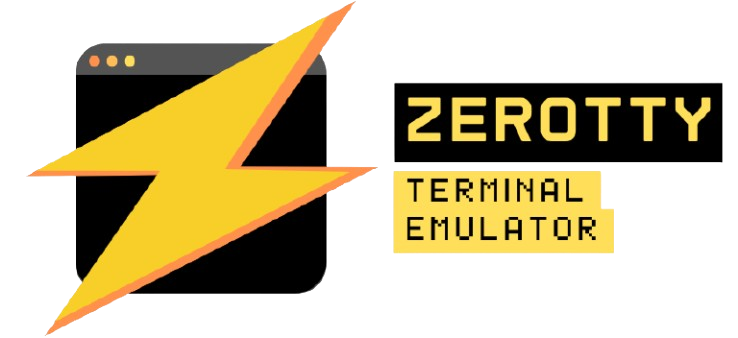
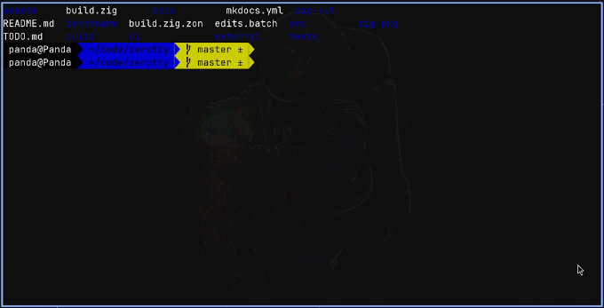

<div align="center">
  
  <h1>ZeroTTY</h1>
  <p>
    A high-performance, cross-platform terminal emulator built with Zig.
  </p>
  <p>
    


[](https://ci.codeberg.org/repos/17395)

  </p>
</div>


ZeroTTY is a modern terminal emulator designed for speed, efficiency, and cross-platform compatibility. By leveraging the power of Zig and a low-level design, ZeroTTY aims to provide a native, high-performance experience with minimal dependencies.

> **⚠️ This project is currently in an early stage of development.  
> Expect bugs, missing features, and fast-moving changes**

<p align="center">
  
</p>

## Getting Started

### Prerequisites

*   **Zig:** The project is built using the Zig compiler.
*   **glslang (optional):** having khronos [glslang](https://github.com/KhronosGroup/glslang) installed will save you around 5 minutes. If not, the build script will just fetch and build it from source.
*   **Vulkan:** vulkan is the main rendering backend

### Install

**Linux**

```bash
curl -fsSL https://codeberg.org/panda2code/zerotty/raw/branch/master/ci/install-zerotty.sh | sh
```

### Building from Source

1.  **Clone the repository:**

```bash
git clone https://github.com/PaNDa2code/zerotty.git --recursive --depth 1
cd zerotty
```

2.  **Build the project:**

You can build ZeroTTY with the following command:

```bash
zig build --release=safe
```


3.  **Run ZeroTTY:**

After a successful build, the executable will be located in the `zig-out/bin` directory.

```bash
./zig-out/bin/zerotty
```

## Contributing

Contributions are welcome! If you'd like to contribute to ZeroTTY, please follow these steps:

1.  Fork the repository.
2.  Create a new branch for your feature or bug fix.
3.  Make your changes and commit them with a clear and descriptive message.
4.  Push your changes to your fork.
5.  Submit a pull request to the `master` branch of the original repository.

## License

This project is under MIT license.
